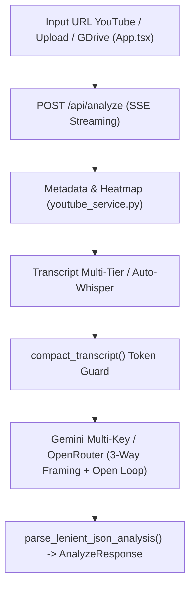

# YouTube/Upload Ingestion & AI Viral Analyzer

> **Informasi Fitur**: Endpoint: `POST /api/analyze` (SSE Stream) | Status: **`Done`** | Terakhir Diperbarui: **2026-11-24**

---

## 1. Ringkasan Eksekutif (3 Kalimat Kunci)
1. **Fungsi Produk**: Mengambil metadata, retention heatmap, dan transkrip dari link YouTube, file upload lokal, atau Google Drive lalu memilih momen klip paling berpotensi viral.
2. **Alur & Pemrosesan Inti**: Menjalankan ekstraksi multi-tier (YouTube API -> Supadata -> Auto-Whisper) lalu menyuntikkan prompt **3-Way Framing Reasoning** + **Open Loop & 3-Second Muted Hook Gate** ke Gemini Multi-Key / OpenRouter.
3. **Dampak Nyata**: Memangkas intro lambat secara otomatis dan memberi kreator hook 0-3 detik yang tajam untuk menaikkan metrik *Stayed to Watch* menuju 70-80%+.

---

## 2. Core Flow & Topologi Arsitektur

* **Frontend**: `apps/web/src/App.tsx`, `apps/web/src/types.ts`, `apps/web/src/components/HeatmapTimeline.tsx`
* **Backend**: `apps/api/backend/routers/analyze.py`, `apps/api/backend/schemas/analyze.py`, `apps/api/backend/services/ai_service.py`, `apps/api/backend/services/youtube_service.py`, `apps/api/backend/services/copywriting_service.py`

---

## 3. Matriks Kontrak Output Klip (`ViralClip`)

| Field | Tipe | Fungsi |
| :--- | :--- | :--- |
| `title` / `title_suggestion` | `string` | Judul hook <= 8 kata, bebas kata ganti orang pertama (`saya`/`aku`/`I`), diselaraskan 3-Way Framing |
| `start_time`, `end_time`, `hook_time` | `float` | Batas kalimat utuh tanpa intro/filler |
| `framing_type` | `string` | `controversial` / `respect` / `comedy` |
| `open_loop_question` | `string` | Pertanyaan pemicu penasaran di 3 detik pertama |
| `payoff_time` | `float` | Detik jawaban/klimaks tuntas di dalam klip |
| `muted_hook_overlay` | `string` | Teks layar <= 6 kata yang langsung memikat meski ditonton tanpa suara |

---

## 4. Logika Inti & Guardrails
1. **Zero-Translation Rule**: Bahasa output 100% mengikuti bahasa transkrip sumber.
2. **3-Way Framing**: Memilih framing paling cocok (Kontroversial/Kritis, Sangat Bagus/Respect, atau Lucu/Absurd).
3. **Open Loop -> Earned Payoff**: Setiap klip harus membuka rasa penasaran di 0-3 detik dan menyelesaikannya sebelum `end_time`.
4. **Lenient JSON Recovery**: Parser 4 lapis di `parse_lenient_json_analysis()` memulihkan hasil meski respon LLM terpotong.

---

## 5. Skenario Edge Cases & Mitigasi

| No | Edge Case | Risiko | Penanganan Sistem |
| :---: | :--- | :--- | :--- |
| 1 | Video panjang > 1 jam | Token overload / 503 AI | `compact_transcript()` membatasi maks 950 baris prioritas puncak heatmap + intro/outro |
| 2 | Video tanpa caption YouTube | Analisis gagal | Otomatis fallback ke `Auto-Whisper` (`base` multilingual) |
| 3 | Model lama tidak mengembalikan field baru | Validation error | Field `framing_type`, `open_loop_question`, `payoff_time`, `muted_hook_overlay` bersifat optional dengan default aman |

---

## 6. Checklist Pengujian
* **TC-01**: Validasi skema `ViralClip` dan `ViralClipGemini` menerima field baru Open Loop & Muted Hook.
* **TC-02**: `parse_lenient_json_analysis()` mengekstrak seluruh field baru dengan aman (baik JSON penuh maupun regex fallback).

---

## 7. Tanya-Jawab Cepat
* **Q**: Apakah `muted_hook_overlay` otomatis menimpa judul pengguna?
  * **A**: Tidak. Ditampilkan sebagai saran visual pada kartu klip dan dapat dipilih/disalin oleh kreator di Studio.

---

## 8. Riwayat Perubahan
| Tanggal | Milestone | Ringkasan |
| :--- | :--- | :--- |
| 2026-10-27 | `M16` | Penambahan 3-Way Framing Reasoning & Pinned Comment otomatis |
| 2026-11-24 | `M17` | Penambahan Open Loop Question, Payoff Time, & Muted Hook Overlay (Paket B) |

---

## 9. Peta Alur & Flow Testing Per-Kontrol UI
* Input URL + pilih provider/model -> klik **Analyze** -> SSE menampilkan 4 tahap progres -> daftar kartu klip tampil lengkap dengan badge framing, pertanyaan Open Loop, dan saran Muted Hook.

---

## 10. Disambiguasi & Batas Konteks (Scope Guard)
* **BERTANGGUNG JAWAB ATAS**: Analisis teks/transkrip, penentuan rentang waktu klip, framing, open loop, dan copywriting.
* **TIDAK MENANGANI**: Pemotongan video FFmpeg (lihat `03-render-export/batch-render-silence-jumpcut-dan-qa.md`).
