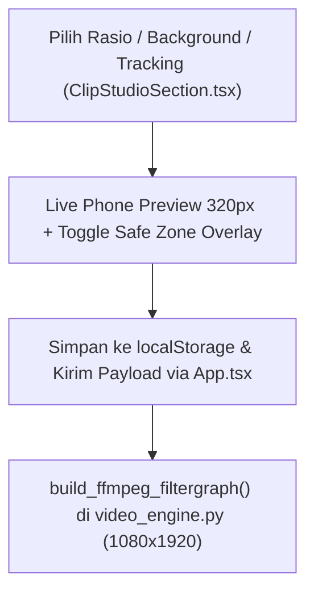

# Canvas Framing, Background Customizer & Safe Zone Overlay 9:16

> **Informasi Fitur**: Komponen: `ClipStudioSection.tsx` + `BackgroundCustomizer.tsx` | Status: **`Done`** | Terakhir Diperbarui: **2026-11-24**

---

## 1. Ringkasan Eksekutif (3 Kalimat Kunci)
1. **Fungsi Produk**: Mengatur rasio video (9:16, 1:1, 4:3, 16:9, Landscape), background kustom/blur, face tracking kamera, serta panduan zona aman UI TikTok/Shorts/Reels.
2. **Alur & Pemrosesan Inti**: Preview CSS 320px memetakan skala dan offset persis 1:1 terhadap kanvas FFmpeg 1080x1920, dilengkapi toggle **Safe Zone Overlay** yang menandai area tombol Like/Share dan deskripsi bawah.
3. **Dampak Nyata**: Mencegah teks judul, subtitle, watermark, maupun wajah kreator terpotong antarmuka aplikasi saat diunggah ke platform short-form.

---

## 2. Core Flow & Topologi Arsitektur

* **Frontend**: `apps/web/src/components/ClipStudioSection.tsx`, `BackgroundCustomizer.tsx`
* **Backend**: `apps/api/backend/routers/backgrounds.py`, `apps/api/backend/video_engine.py`

---

## 3. Matriks Kontrak Parameter Utama
* `aspectRatio` <-> `aspect_ratio` (`"9:16" | "1:1" | "4:3" | "16:9" | "16:9_landscape"`)
* `backgroundType` / `backgroundValue` / `backgroundFilePath` <-> `background_type` / `background_value` / `background_file_path`
* `cameraTrackingMode` / `trackingSmoothness` <-> `camera_tracking_mode` / `tracking_smoothness`
* `showSafeZoneOverlay` (state preview UI murni, tidak mengubah hasil render MP4)

---

## 4. Logika Inti & Guardrails
* Safe Box 9:16 universal: `top 11.5% (220px)`, `bottom 25% (480px)`, `right 15.2% (164px)`, `left 6% (64px)`.
* Overlay Safe Zone memakai `pointer-events: none` agar tidak menghalangi klik play/pause atau drag watermark pada pratinjau.

---

## 5. Skenario Edge Cases & Mitigasi
| No | Edge Case | Risiko | Penanganan |
| :---: | :--- | :--- | :--- |
| 1 | Aspect ratio `16:9_landscape` aktif | Overlay 9:16 salah posisi | Safe Zone vertical hanya tampil saat rasio non-landscape (`!isLandscape`) |

---

## 6. Checklist Pengujian
* **TC-01**: Toggle Safe Zone di header preview menampilkan dan menyembunyikan panduan area tombol kanan + deskripsi bawah tanpa menghalangi kontrol video.

---

## 7. Tanya-Jawab Cepat
* **Q**: Apakah garis merah Safe Zone ikut terekam di video MP4?
  * **A**: Tidak. Panduan Safe Zone murni lapisan visual di browser Preview.

---

## 8. Riwayat Perubahan
| Tanggal | Milestone | Ringkasan |
| :--- | :--- | :--- |
| 2026-10-13 | `M13` | Smart Camera Tracking (Fit Balanced, Close-Up, Gimbal Smoothstep) |
| 2026-11-24 | `M17` | Penambahan toggle Safe Zone Overlay TikTok/Shorts/Reels di Phone Preview |

---

## 9. Peta Alur & Flow Testing Per-Kontrol UI
* Klik tombol **`Safe Zone`** di bar atas Phone Preview -> area unsafe merah transparan (Atas Search, Kanan Like/Share, Bawah Caption) muncul di layar preview.

---

## 10. Disambiguasi & Batas Konteks (Scope Guard)
* **BERTANGGUNG JAWAB ATAS**: Kanvas, rasio, background, face tracking, dan Safe Zone visual guide.
* **TIDAK MENANGANI**: Rendering subtitle ASS/SRT dan upload Reaction Cam PIP (lihat `subtitle-title-dan-reaction-cam.md`).
