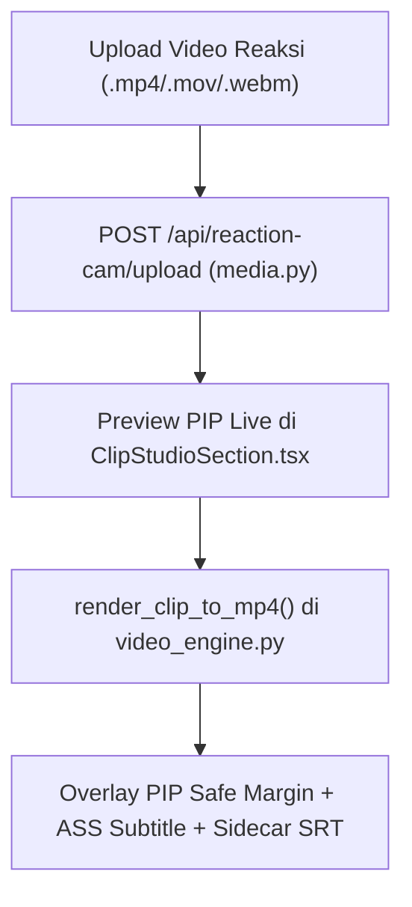

# Subtitle ASS/SRT, Title Emoji & Creator Reaction Cam PIP

> **Informasi Fitur**: Endpoint: `POST /api/reaction-cam/upload`, `GET /api/reaction-cam/{file_name}` | Status: **`Done`** | Terakhir Diperbarui: **2026-11-24**

---

## 1. Ringkasan Eksekutif (3 Kalimat Kunci)
1. **Fungsi Produk**: Merender subtitle karaoke presisi kata dengan opsi **High-Contrast Box**, sidecar `.srt` untuk SEO, judul emoji penuh warna, serta overlay video reaksi muka kreator (PIP) untuk personal branding dan *Transformative Fair Use*.
2. **Alur & Pemrosesan Inti**: Video reaksi diunggah ke server lalu di-loop otomatis (`-stream_loop -1`), dipotong lingkaran/kotak dengan margin aman 9:16, dan audio reaksinya dibisukan secara default; subtitle ASS menjaga durasi minimum >= 0.40s anti-kedip dan mengekspor `.srt` pendamping.
3. **Dampak Nyata**: Teks tetap kontras terbaca di segala latar video, wajah kreator tidak tertutup tombol TikTok/Shorts, dan klip terlindungi dari klaim konten berulang.

---

## 2. Core Flow & Topologi Arsitektur

* **Frontend**: `apps/web/src/components/ClipStudioSection.tsx`, `types.ts`, `locales/id.ts`, `locales/en.ts`, `App.tsx`
* **Backend**: `apps/api/backend/routers/media.py`, `schemas/render.py`, `services/render_service.py`, `video_engine.py`

---

## 3. Matriks Kontrak Parameter (5-Point Sync)

| Frontend (`types.ts`) | Payload (`App.tsx` / `render.py`) | Default | Keterangan |
| :--- | :--- | :--- | :--- |
| `captionStyle` | `caption_style` | `"viral_pop"` | Mendukung preset baru `"high_contrast_box"` (`BorderStyle=3` box gelap kontras tinggi) |
| `reactionCamEnabled` | `reaction_cam_enabled` | `false` | Toggle aktif/nonaktif overlay PIP kreator |
| `reactionCamFilePath` | `reaction_cam_file_path` | `null` | Path file video reaksi di server |
| `reactionCamPosition` | `reaction_cam_position` | `"bottom_right"` | Margin aman 9:16: `m_x_right=156`, `m_x_left=56`, `m_y_bottom=380`, `m_y_top=220` |
| `reactionCamSize` | `reaction_cam_size` | `24` | 15% sampai 40% lebar kanvas |
| `reactionCamShape` | `reaction_cam_shape` | `"circle"` | `"circle"` (alpha `geq hypot`) atau `"rounded_rect"` |
| `reactionCamBorderColor` | `reaction_cam_border_color` | `"white"` | `"white" | "gold" | "cyan" | "none"` |
| `reactionCamMuteAudio` | `reaction_cam_mute_audio` | `true` | Default mute agar vokal asli tetap bersih |

---

## 4. Logika Inti & Guardrails
1. **Anti-Caption-Flash (`showtime qa`)**: Durasi minimum chunk subtitle dinaikkan dari `0.25s` menjadi `0.40s` (tetap di-clamp oleh start chunk berikutnya agar tidak pernah tumpang tindih).
2. **High-Contrast Box**: Menggunakan `BorderStyle=3` (opaque/translucent dark box `&H550A0A0F` dengan outline bersih) agar teks putih tetap lolos kontras WCAG AA di atas footage terang.
3. **Sidecar `.srt`**: `generate_srt_file()` menghasilkan file `.srt` bersih dari word timestamps yang sama lalu dibundel ke ZIP ekspor.

---

## 5. Skenario Edge Cases & Mitigasi
| No | Edge Case | Risiko | Penanganan |
| :---: | :--- | :--- | :--- |
| 1 | Durasi video reaksi lebih pendek dari klip | Overlay hilang di tengah | `-stream_loop -1` + `-shortest` |
| 2 | Video reaksi memiliki suara ruangan bising | Merusak audio dialog utama | Default `reaction_cam_mute_audio = True` |
| 3 | Posisi `bottom_right` pada 9:16 | Tertutup tombol Like/Share & caption | Margin kanan `156px` dan bawah `380px` sesuai Safe Box |

---

## 6. Checklist Pengujian
* **TC-01**: Render dengan `caption_style="high_contrast_box"` + `reaction_cam_enabled=True` menghasilkan MP4 valid + sidecar `.srt`.
* **TC-02**: Preview PIP di `ClipStudioSection.tsx` ikut berpindah posisi aman sesuai pilihan sudut.

---

## 7. Tanya-Jawab Cepat
* **Q**: Apa bedanya Reaction Cam ini dengan preset `pip_corner`?
  * **A**: `pip_corner` memotong webcam dari dalam video sumber YouTube; Reaction Cam menempelkan file video wajah Anda sendiri yang diunggah terpisah.

---

## 8. Riwayat Perubahan
| Tanggal | Milestone | Ringkasan |
| :--- | :--- | :--- |
| 2026-10-27 | `M16` | Implementasi lengkap Creator Reaction Cam PIP Overlay |
| 2026-11-24 | `M17` | Kalibrasi margin Safe Zone 9:16, preset `high_contrast_box`, anti-caption-flash >= 0.40s, dan export `.srt` |

---

## 9. Peta Alur & Flow Testing Per-Kontrol UI
* Aktifkan kartu Reaction Cam -> unggah `.mp4` -> pilih sudut/bentuk/ukuran -> aktifkan Safe Zone preview -> verifikasi wajah berada di area aman -> render.

---

## 10. Disambiguasi & Batas Konteks (Scope Guard)
* **BERTANGGUNG JAWAB ATAS**: Subtitle ASS/SRT, Title Emoji PNG, dan Creator Reaction Cam PIP.
* **TIDAK MENANGANI**: Streamer facecam crop dari video sumber (`streamerPreset="pip_corner"`).
