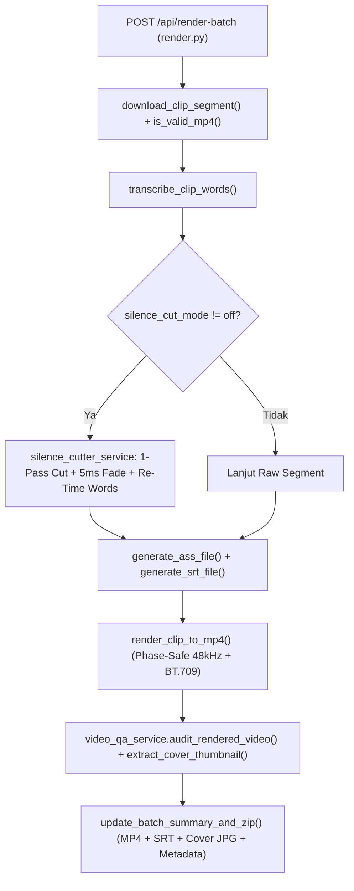

# Batch Render, Auto-Trim Dead Air Jumpcut, Audio Phase-Safe & Post-Render QA

> **Informasi Fitur**: Endpoint: `POST /api/render-batch`, `GET /api/render-batch-status/{batch_id}` | Status: **`Done`** | Terakhir Diperbarui: **2026-11-24**

---

## 1. Ringkasan Eksekutif (3 Kalimat Kunci)
1. **Fungsi Produk**: Mengorkestrasi proses unduh segmen, pemangkasan dead air otomatis (Smart Jumpcut), mastering audio tahan fase terbalik, render FFmpeg GPU/CPU, verifikasi QA otomatis pasca-render, hingga pengemasan ZIP siap upload.
2. **Alur & Pemrosesan Inti**: Segmen dipotong 1-pass dengan micro-fade 5 ms sambil menggeser ulang timestamp kata, dirender di AAC 48 kHz + BT.709, diaudit oleh `video_qa_service.py`, lalu dikemas bersama `.srt`, `cover_*.jpg`, `metadata_*.txt`, dan `copy_deck_*.json`.
3. **Dampak Nyata**: Menghilangkan jeda kosong pembunuh retensi di 0-3 detik pertama, mencegah bug audio hilang akibat fase stereo terbalik, dan memberi lencana QA transparan sebelum kreator mengunggah klip.

---

## 2. Core Flow & Topologi Arsitektur

* **Backend**: `apps/api/backend/services/render_service.py`, `silence_cutter_service.py`, `video_qa_service.py`, `video_engine.py`, `schemas/render.py`
* **Frontend**: `apps/web/src/components/ClipStudioSection.tsx`, `BatchRenderProgressModal.tsx`, `App.tsx`, `types.ts`

---

## 3. Matriks Kontrak Parameter Baru (Paket B)

| Frontend (`types.ts`) | Payload (`App.tsx` / `render.py`) | Default | Keterangan |
| :--- | :--- | :--- | :--- |
| `silenceCutMode` | `silence_cut_mode` | `"off"` | `"off"` / `"natural"` (gap >= 0.55s) / `"snappy"` (gap >= 0.35s) |
| `clip.qa_report` *(response)* | `clip_status["qa_report"]` | `null` | Ringkasan audit pasca-render (`status`, `lufs`, `true_peak_db`, `first_frame_ok`, `leading_silence_sec`, `frozen_count`, `issues`) |

---

## 4. Logika Inti & Guardrails
1. **Smart Silence Jumpcut (`silence_cutter_service.py`)**:
   * Head dead air dipangkas ke `0.12s` agar suara masuk langsung di awal video.
   * Jeda antar-kata >= threshold dipangkas dengan menyisakan nafas adaptif (`0.14s` biasa, `0.20s` akhir kalimat `.!?`, `0.24s` jeda >= 2.0s).
   * Setiap potongan memakai `afade` masuk/keluar `0.005s` (5 ms) agar bebas bunyi *click/pop*.
   * Jika total waktu yang dipangkas < `0.25s`, pemotongan dilewati (hemat CPU & bebas re-encode tak perlu).
2. **Phase-Safe Vocal Isolation (`video_engine.py`)**:
   * `detect_safe_mono_pan()` mengukur volume RMS kanal L, R, dan L+R; jika L+R drop > 6 dB (fase terbalik), otomatis pilih kanal tunggal terkuat.
3. **Post-Render QA (`video_qa_service.py`)**:
   * Memeriksa integritas stream, Frame 0 (anti layar hitam), Integrated LUFS, True Peak, Leading Silence, dan Freeze Detect, lalu melampirkan status `PASS` / `WARN` / `FAIL` ke modal render.

---

## 5. Skenario Edge Cases & Mitigasi
| No | Edge Case | Risiko | Penanganan |
| :---: | :--- | :--- | :--- |
| 1 | Audio stereo inverted phase | Suara lenyap saat center vocal extract | `detect_safe_mono_pan()` otomatis fallback ke kanal terkuat |
| 2 | Klip tidak punya jeda hening | Re-encode sia-sia | `silence_cutter_service` langsung skip bila `removed_sec < 0.25` |
| 3 | QA probe timeout pada file sangat panjang | Menghambat selesai batch | Timeout ketat + graceful fallback `status="SKIP"` agar MP4 tetap bisa diunduh |

---

## 6. Checklist Pengujian
* **TC-01**: `qa-kernel.py` Test A, B, C, D lulus 100%.
* **TC-02**: Paket ZIP memuat `.mp4`, `.srt`, `cover_*.jpg`, `metadata_*.txt`, dan `copy_deck_*.json`.

---

## 7. Tanya-Jawab Cepat
* **Q**: Apakah Auto-Trim Dead Air menggeser subtitle menjadi tidak sinkron?
  * **A**: Tidak, karena `apply_silence_cut()` mengembalikan `retimed_words` yang sudah dikurangi akumulasi durasi jeda terpotong sebelum `.ass` dan `.srt` dibuat.

---

## 8. Riwayat Perubahan
| Tanggal | Milestone | Ringkasan |
| :--- | :--- | :--- |
| 2026-10-27 | `M16` | Fix FFmpeg `asplit=2` ducking & hapus blok duplikat hook zoom |
| 2026-11-24 | `M17` | Implementasi Paket B: Phase-Safe 48 kHz, Silence Jumpcut + 5ms fade, `video_qa_service.py`, SRT & Cover JPG di ZIP |

---

## 9. Peta Alur & Flow Testing Per-Kontrol UI
* Pilih mode **Auto-Trim Dead Air** (`Off` / `Natural` / `Snappy`) di kartu Ultra-Quality Studio -> klik **Start Batch Render** -> modal menampilkan progress lalu saat selesai memunculkan **QA Badge (`PASS`/`WARN`)** lengkap dengan detail LUFS, Frame 0, dan tombol unduh MP4/ZIP.

---

## 10. Disambiguasi & Batas Konteks (Scope Guard)
* **BERTANGGUNG JAWAB ATAS**: Jalur server render (`render_single_batch_clip` & `render_merged_batch_clips`), silence jumpcut, audio mastering, QA pasca-render, dan paket ZIP.
* **TIDAK MENANGANI**: Render client-side WASM di `apps/web/src/services/clientRenderer.ts`.
