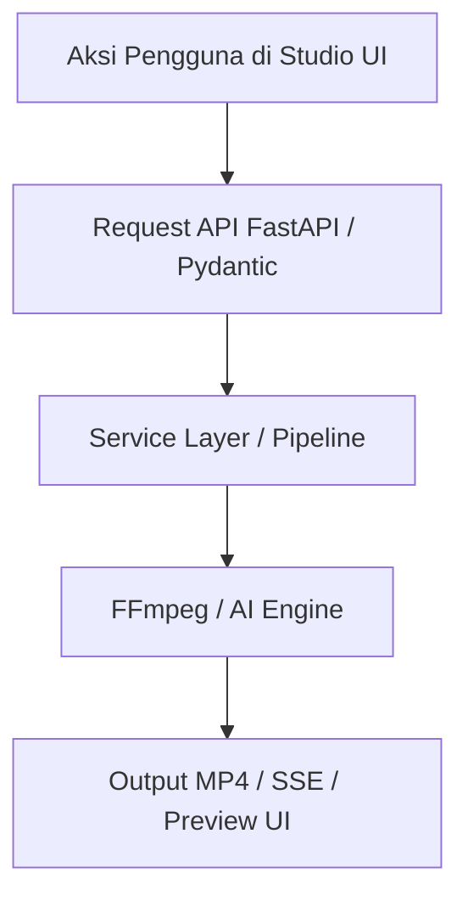

# [Nama Fitur Resmi]

> **Informasi Fitur**: Endpoint/Komponen: `[route]` | Status: **`[Status]`** | Terakhir Diperbarui: **[Tanggal]**

---

## 1. Ringkasan Eksekutif (3 Kalimat Kunci)
1. **Fungsi Produk**: [1 kalimat peran fitur ini bagi kreator Shorts/Reels/TikTok].
2. **Alur & Pemrosesan Inti**: [1 kalimat bagaimana data/media diolah dari UI sampai output].
3. **Dampak Nyata**: [1 kalimat dampak ke retensi, kualitas visual/audio, atau kecepatan kerja].

---

## 2. Core Flow & Topologi Arsitektur

### Diagram Alir (Mermaid)

### Peta Komponen (Monorepo ClipVidio AI)
* **Frontend UI**: `apps/web/src/components/...`
* **Frontend Types & Locales**: `apps/web/src/types.ts`, `apps/web/src/locales/id.ts`, `en.ts`
* **Backend Router**: `apps/api/backend/routers/...`
* **Backend Schema**: `apps/api/backend/schemas/...`
* **Backend Service / Engine**: `apps/api/backend/services/...`, `apps/api/backend/video_engine.py`

---

## 3. Matriks Kontrak Parameter (5-Point Sync)

| Frontend (`types.ts` / `ClipStudioSection.tsx`) | Payload (`App.tsx`) | Schema (`schemas/*.py`) | Backend Service / Engine | Default & Rentang |
| :--- | :--- | :--- | :--- | :--- |
| `camelCaseField` | `snake_case_field` | `snake_case_field` | `video_engine.py` | `default` |

---

## 4. Logika Inti & Guardrails
1. [Aturan validasi input & keamanan]
2. [Aturan filtergraph / AI prompt / fallback aman]

---

## 5. Skenario Edge Cases & Mitigasi

| No | Edge Case | Risiko | Penanganan Sistem |
| :---: | :--- | :--- | :--- |
| 1 | [Kasus 1] | [Dampak] | [Fallback / Guard] |

---

## 6. Checklist Pengujian (Tier 1 `qa-kernel.py` & Build)

| ID Uji | Skenario | Hasil yang Diharapkan |
| :--- | :--- | :--- |
| TC-01 | Happy path | Output valid tanpa error |
| TC-02 | Edge case / fallback | Tetap selesai aman tanpa crash |

---

## 7. Tanya-Jawab Cepat (FAQ Teknis)
* **Q**: [Pertanyaan umum]?
  * **A**: [Jawaban ringkas berbasis fakta kode].

---

## 8. Riwayat Perubahan (Changelog)

| Tanggal | Milestone | Ringkasan Perubahan |
| :--- | :--- | :--- |
| YYYY-MM-DD | `MXX` | [Rincian perubahan] |

---

## 9. Peta Alur & Flow Testing Per-Kontrol UI

| No | Kontrol UI (`TSX`) | State & Handler | Endpoint / Payload | Efek Preview & Render |
| :---: | :--- | :--- | :--- | :--- |
| 1 | [Tombol / Toggle / Slider] | `state` / `handler()` | `field_name` | [Dampak visual/FFmpeg] |

---

## 10. Disambiguasi & Batas Konteks (Scope Guard)
* **Fitur ini BERTANGGUNG JAWAB ATAS**: [ruang lingkup inti].
* **Fitur ini TIDAK MENANGANI**: [fitur kembar yang ditangani modul lain, merujuk `cross-feature-disambiguation.md`].
